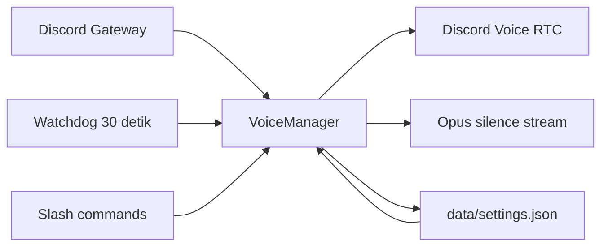

<div align="center">

# Discord Voice 24/7

**Bot Discord ringan untuk menjaga satu voice channel tetap aktif sepanjang waktu.**

[](https://nodejs.org/)
[](https://discord.js.org/)
[](LICENSE)
[](https://github.com/kexlyu24/discord-voice-247-bot/commits/main)

Silent keepalive · Auto-reconnect · Persistent configuration · VPS monitoring · Configurable Rich Presence

</div>

## Tentang proyek

Discord Voice 24/7 mempertahankan bot di voice channel yang dipilih, termasuk saat channel kosong. Bot mengirim Opus silence frames untuk menjaga jalur audio aktif, memantau koneksi setiap 30 detik, dan mencoba bergabung kembali ketika terputus, dipindahkan, atau dikeluarkan.

Konfigurasi channel, mode 24/7, dan Rich Presence disimpan di `data/settings.json`. Setelah proses atau VPS restart, bot memulihkan konfigurasi tersebut secara otomatis.

## Fitur

- **Voice 24/7** — tetap berada di channel target saat tidak ada anggota lain.
- **Silent keepalive** — Opus silence stream tanpa FFmpeg.
- **Auto-reconnect** — menangani perubahan voice state dan gangguan RTC.
- **Watchdog 30 detik** — mendeteksi koneksi yang tidak lagi sinkron.
- **Persistent state** — channel target dan presence bertahan setelah restart.
- **VPS monitoring** — `/status` menampilkan penggunaan CPU dan RAM host.
- **Rich Presence** — administrator dapat mengubah aktivitas bot dari Discord.
- **PM2 ready** — konfigurasi production dan auto-start setelah reboot tersedia.

## Slash commands

| Command | Akses | Fungsi |
|---|---|---|
| `/join [channel]` | Semua anggota | Bergabung ke channel yang dipilih atau channel pengguna, lalu mengaktifkan mode 24/7. |
| `/leave` | Semua anggota | Keluar dari voice channel dan menonaktifkan mode 24/7. |
| `/stay <aktif>` | Semua anggota | Mengaktifkan atau menonaktifkan auto-reconnect. |
| `/status` | Semua anggota | Menampilkan voice target, RTC, ping, uptime, CPU VPS, dan RAM VPS. |
| `/presence <tipe> <teks>` | Administrator | Mengatur aktivitas `Watching`, `Playing`, `Listening`, atau `Competing`. |

Contoh:

```text
/presence tipe:Watching teks:NOIRÉL
```

## Persyaratan

- Node.js **22.12.0 atau lebih baru**
- Bot Discord dengan permission `View Channels`, `Connect`, `Speak`, `Send Messages`, dan `Embed Links`
- Host yang tetap menyala dan mengizinkan koneksi HTTPS, WebSocket, dan UDP keluar

Privileged Gateway Intents dan FFmpeg tidak diperlukan.

## Instalasi

### 1. Clone dan pasang dependensi

```bash
git clone https://github.com/kexlyu24/discord-voice-247-bot.git
cd discord-voice-247-bot
npm ci
```

### 2. Buat konfigurasi

Linux/macOS:

```bash
cp .env.example .env
```

Windows:

```powershell
Copy-Item .env.example .env
```

Isi `.env`:

```env
DISCORD_TOKEN=token_bot_discord
CLIENT_ID=application_id_bot
GUILD_ID=id_server_discord
TARGET_CHANNEL_ID=id_voice_channel
SELF_DEAF=true
SELF_MUTE=true
```

| Variabel | Wajib | Keterangan |
|---|---:|---|
| `DISCORD_TOKEN` | Ya | Token rahasia dari Discord Developer Portal. |
| `CLIENT_ID` | Ya | Application ID untuk registrasi slash commands. |
| `GUILD_ID` | Disarankan | Registrasi command langsung ke satu server. |
| `TARGET_CHANNEL_ID` | Disarankan | Voice channel yang dimasuki saat startup pertama. |
| `SELF_DEAF` | Tidak | Default `true`; bot tidak menerima audio anggota. |
| `SELF_MUTE` | Tidak | Default `false`; atur `true` jika bot harus tampil muted. |

> Jangan commit `.env` atau membagikan token bot. Jika token pernah terekspos, reset segera di Discord Developer Portal.

### 3. Daftarkan command dan jalankan

```bash
npm run deploy
npm start
```

Jika command belum tampil setelah deployment, refresh Discord. Registrasi dengan `GUILD_ID` biasanya tersedia segera; registrasi global dapat memerlukan waktu propagasi.

## Deployment VPS dengan PM2

```bash
sudo npm install -g pm2
pm2 start ecosystem.config.cjs
pm2 save
pm2 startup
```

Jalankan perintah lanjutan yang dicetak oleh `pm2 startup`, lalu verifikasi:

```bash
pm2 status
pm2 logs discord-voice-247
```

Konfigurasi PM2 menjalankan `src/index.js`, merestart proses yang gagal, dan membatasi restart saat penggunaan memori mencapai 300 MB.

## Menjalankan di Windows

Klik `start.bat` atau jalankan:

```powershell
.\start.bat
```

Script memasang dependensi jika `node_modules` belum ada dan menjalankan ulang bot lima detik setelah proses berhenti. Komputer harus tetap menyala dan sleep mode harus dimatikan.

## Cara kerja



1. `VoiceManager` bergabung menggunakan adapter voice milik guild.
2. Setelah RTC berstatus `Ready`, audio player mengirim Opus silence frames.
3. `voiceStateUpdate` mendeteksi bot keluar atau dipindahkan dari channel target.
4. Watchdog membandingkan voice state aktual dengan status RTC setiap 30 detik.
5. Konfigurasi tersimpan dipakai untuk pemulihan setelah restart.

## Struktur proyek

```text
src/
├── commands/
│   ├── join.js
│   ├── leave.js
│   ├── presence.js
│   ├── status.js
│   └── stay.js
├── managers/
│   └── voiceManager.js
├── utils/
│   └── presence.js
├── deploy-commands.js
└── index.js
```

## Troubleshooting

### Bot terlihat di channel tetapi RTC terus `Connecting`

Pastikan dependency terbaru terpasang dan restart proses:

```bash
git pull --ff-only
npm ci
pm2 restart discord-voice-247 --update-env
```

### Slash command tidak muncul

Pastikan `CLIENT_ID` dan `GUILD_ID` benar, kemudian:

```bash
npm run deploy
```

### Bot tidak kembali setelah reboot VPS

```bash
pm2 save
pm2 startup
systemctl status pm2-$USER
```

### Melihat log

```bash
pm2 logs discord-voice-247 --lines 100
```

## Keamanan

- Jangan pernah menyimpan token di Git, issue, screenshot, atau chat.
- Jalankan bot sebagai user non-root jika lingkungan deployment memungkinkan.
- Batasi akses file `.env` pada Linux dengan `chmod 600 .env`.
- Ikuti panduan pelaporan di [SECURITY.md](SECURITY.md).

## Lisensi

Dirilis di bawah [MIT License](LICENSE).
