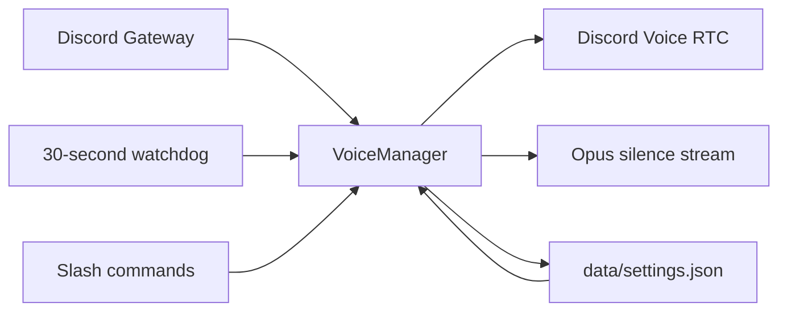

<div align="center">

# Discord Voice 24/7

**A self-hosted Discord bot for keeping your community's voice channel connected.**

[](https://nodejs.org/)
[](https://discord.js.org/)
[](LICENSE)
[](https://github.com/kexlyu24/discord-voice-247-bot/commits/main)

Silent keepalive · Auto-reconnect · Voice analytics · VPS monitoring · Custom presence

</div>

## About

Discord Voice 24/7 stays in your selected voice channel, including when it is empty. It sends Opus silence frames, checks connection state every 30 seconds, and attempts to reconnect after disconnections or channel moves.

The target channel, reconnect mode, and presence are saved in `data/settings.json` and restored on startup. Voice activity is stored locally in `data/analytics.db`.

> Designed for one Discord server per instance. Continuous operation depends on your host, network, permissions, and Discord availability—not an uptime guarantee.

## Features

- **Voice 24/7** — stays connected even when nobody else is in the channel.
- **Silent keepalive** — Opus silence streaming without FFmpeg.
- **Auto-reconnect** — recovery after voice-state changes and RTC interruptions.
- **30-second watchdog** — checks for inconsistent connection state.
- **Persistent settings** — restores the target channel and presence after restarts.
- **VPS monitoring** — host CPU and RAM usage through `/status`.
- **Custom presence** — Watching, Playing, Listening, and Competing activities.
- **Voice analytics** — local SQLite storage, activity heatmaps, streaks, and session records.
- **PM2 ready** — process management and boot-start configuration for VPS deployments.

## Slash commands

| Command | Access | Description |
|---|---|---|
| `/join [channel]` | Members with command access | Joins the selected channel or your current channel and enables reconnect mode. |
| `/leave` | Members with command access | Leaves voice and disables reconnect mode. |
| `/stay <aktif>` | Members with command access | Enables or disables reconnect mode without leaving. |
| `/status` | Members with command access | Shows voice state, connection duration, latency, uptime, and host CPU/RAM usage. |
| `/insights heatmap [days]` | Members with command access | Displays an activity heatmap for 1–90 days; defaults to 30. |
| `/insights records` | Members with command access | Shows group and individual records, daily streaks, and the top three members. |
| `/presence <tipe> <teks>` | Administrator or Manage Server | Changes the bot's activity type and text. |

Example:

```text
/presence tipe:Watching teks:NOIRÉL
```

Bot command options and replies remain in Indonesian. `/presence` replies are private; other command replies are public. Use Discord's application-command permissions to restrict access.

### Reading the analytics

Heatmaps use **WIB (UTC+7)** and completed member sessions. A session's entire duration is credited to its starting hour, rather than split across hours. Totals represent accumulated member-time, not speaking time.

Records include the longest stored group and individual sessions, a streak for completed group activity with at least two non-bot members, and a top-three ranking over 30 days. Active sessions appear after completion or graceful shutdown; abrupt termination can lose in-memory sessions. Analytics records membership metadata, not audio.

## Requirements

- **Node.js 22.13.0+**; Node.js 24 LTS recommended.
- A bot application from the [Discord Developer Portal](https://discord.com/developers/applications).
- A continuously running host with writable storage and outbound HTTPS, WebSocket, and UDP access.

Invite the bot with `bot` and `applications.commands` scopes. Grant **View Channels**, **Connect**, **Speak**, **Send Messages**, and **Embed Links** in the relevant channels.

Privileged Gateway Intents and FFmpeg are not required.

## Installation

### 1. Clone and install

```bash
git clone https://github.com/kexlyu24/discord-voice-247-bot.git
cd discord-voice-247-bot
npm ci
```

### 2. Configure

Linux/macOS:

```bash
cp .env.example .env
```

Windows PowerShell:

```powershell
Copy-Item .env.example .env
```

Edit `.env`:

```env
DISCORD_TOKEN=your_bot_token
CLIENT_ID=your_application_id
GUILD_ID=your_server_id
TARGET_CHANNEL_ID=your_voice_channel_id
SELF_DEAF=true
SELF_MUTE=true
```

| Variable | Required | Description |
|---|---|---|
| `DISCORD_TOKEN` | Yes | Private bot token from the Developer Portal. |
| `CLIENT_ID` | For registration | Application ID used to register commands. |
| `GUILD_ID` | Recommended | Registers commands in one server; also needed for initial auto-join. |
| `TARGET_CHANNEL_ID` | Optional | Initial voice target; set together with `GUILD_ID`, or use `/join`. |
| `SELF_DEAF` | No | Defaults to `true` unless explicitly disabled. |
| `SELF_MUTE` | No | Defaults to `false`; the example sets it to `true`. |

Saved targets take precedence over environment defaults. Use `/join` to change an existing target.

> Never commit `.env` or share your token. Reset exposed tokens in the Discord Developer Portal.

### 3. Register commands and start

```bash
npm run deploy
npm start
```

With `GUILD_ID`, commands are registered in that server. Without it, registration is global and may take time to propagate. Re-register when command definitions change; the script replaces commands in the selected scope.

## VPS deployment with PM2

Run from the project directory:

```bash
npm install -g pm2
pm2 start ecosystem.config.cjs
pm2 save
pm2 startup
```

Follow the additional command printed by `pm2 startup`, then check:

```bash
pm2 status
pm2 logs discord-voice-247
```

The configuration runs `src/index.js`, restarts failed processes, and requests a restart at `300M` memory usage. This is not a hard memory cap.

## Running on Windows

Launch `start.bat` from the project directory:

```powershell
.\start.bat
```

The launcher installs dependencies if `node_modules` is missing and restarts the bot five seconds after it exits. Keep the computer awake. The launcher does not configure automatic startup after reboot.

Run only one bot process per configuration and data directory.

## How it works



1. `VoiceManager` joins using the guild's voice adapter.
2. When RTC reaches `Ready`, the audio player streams silence frames.
3. Voice-state events detect disconnections and channel moves.
4. The watchdog checks actual channel membership against RTC state.
5. Saved settings support recovery after process restarts.

## Project structure

```text
src/
├── commands/
│   ├── insights.js
│   ├── join.js
│   ├── leave.js
│   ├── presence.js
│   ├── status.js
│   └── stay.js
├── managers/
│   ├── analyticsManager.js
│   └── voiceManager.js
├── utils/
│   └── presence.js
├── deploy-commands.js
└── index.js
```

## Troubleshooting

### The bot is in voice but RTC stays Connecting

Check logs, channel permissions, and outbound UDP connectivity. To install repository updates:

```bash
git pull --ff-only
npm ci
pm2 restart discord-voice-247 --update-env
```

### Slash commands are missing

Check `CLIENT_ID`, `GUILD_ID`, invitation scopes, and command permissions, then run:

```bash
npm run deploy
```

### The bot does not return after a VPS reboot

```bash
pm2 save
pm2 startup
systemctl status pm2-$USER
```

Follow the startup instructions for the account running PM2. Also check that reconnect mode is enabled.

### View logs

```bash
pm2 logs discord-voice-247 --lines 100
```

## Security and storage

- Keep tokens, credentials, logs, and activity databases out of public repositories.
- Run as a non-root service account where possible.
- On Linux, restrict environment-file access with `chmod 600 .env`.
- Keep `data/` on persistent storage and back it up with the bot stopped.
- Inform members about activity tracking; there is no automatic data-retention policy.
- Read [SECURITY.md](SECURITY.md) for reporting guidance.

## License

Released under the [MIT License](LICENSE).
